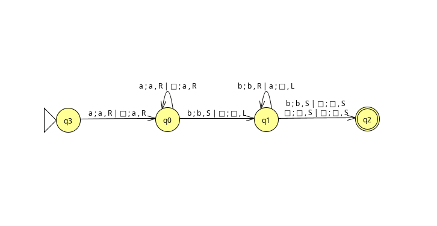
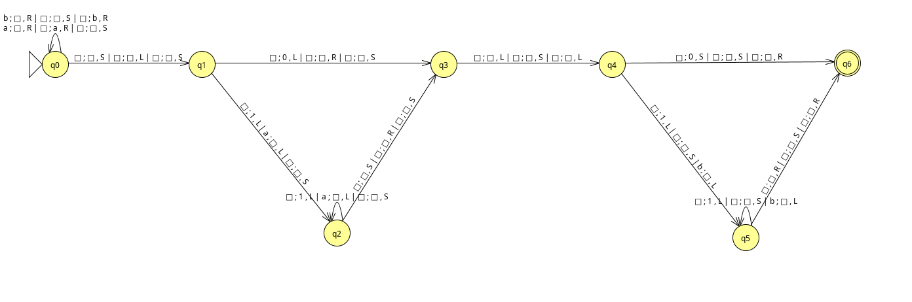

# 26-27-ComputationalComplexity-p02-TuringMachine

The Turing machine processes an input string by reading symbols from the tape 
and manipulating the tape head according to its transition function. A string 
is accepted if the automaton halts in an accepting state.

The program prompts the user to enter input strings one at a time via the 
keyboard. For each string, the automaton processes the input and displays the 
tapes on the screen at each step of the computation.

## Problem description

A Turing Machine (MT) is a formal computational model defined as a 7-tuple

$$M = (Q, \Sigma, \Gamma, q_0, \square, F, \delta)$$

where:

($Q$) is a finite set of states.

($\Sigma$) is the input alphabet.

($\Gamma$) is the tape alphabet.

($q_0 \in Q$) is the initial state.

($\square \in \Gamma$) is the blank symbol.

($F \subseteq Q$) is the set of accepting states.

($\delta$) is the transition function, defined as 
$\delta: Q \times \Gamma \rightarrow Q \times \Gamma \times \{L, R\}$

## Available Turing Machines

> Turing Machine with simultaneous or independent writing and movement
$$\delta: Q \times \Gamma^k \rightarrow Q \times \{ \Gamma^k \cup \{L, R\}^k\}$$

> ### Selected: Turing Machine whose only moves are left (L) and right (R), or which also includes the option of no move (S)
### $$\delta: Q \times \Gamma^k \rightarrow Q \times (\Gamma \times \{L, R, S\})^k$$

> Turing Machine with a single-infinite tape or a double-infinite tape
$$\delta: Q \times \Gamma^k \rightarrow Q \times (\Gamma \times \{L, R\})^k$$

## Designed Turing Machines paths

As configuration files [designed Turing Machine 1](./data/designedTM-1.txt), 
[designed Turing Machine 2](./data/designedTM-2.txt)

As images [designed Turing Machine 1](./img/designedTM-1.png), 
[designed Turing Machine 2](./img/designedTM-2.png) ...

 


## Run code

```
mkdir build
cd build
cmake ..
make
/turing-machine -help
```

## Other information

This code was developed by 
* [Cristhian Adoney Cruz Delgado](https://github.com/CristhianCruzDelgado)

Contact emails 
* <alu0101648293@ull.edu.es>

This code was designed for Computational Complexity, \
signature of the Computer Engineering degree, \
that is studied at the Univeridad de La Laguna.

_3 October 2026_
